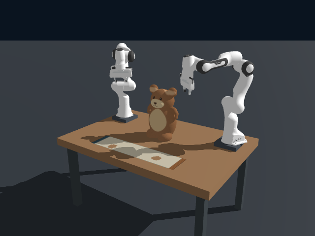
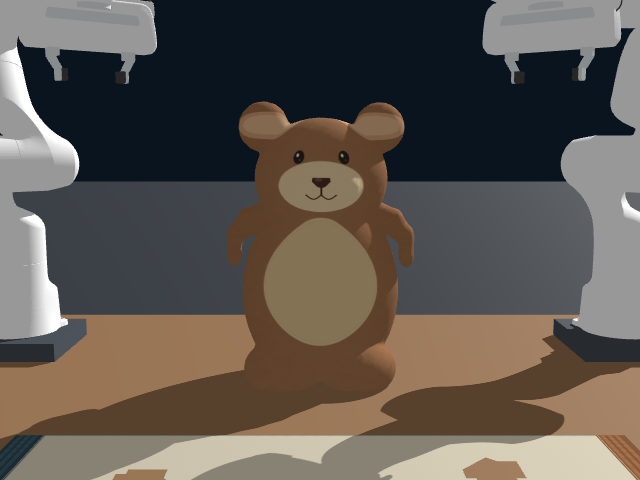
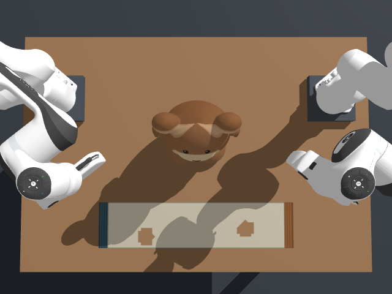
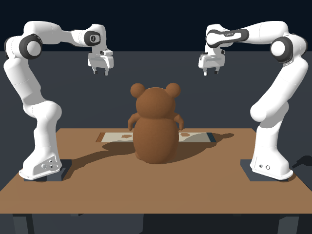

# Bear Arms Scene - Plush Bear & Cotton

这是 `Chloe-Jinlei/bear_arms_scene` 的毛绒填充体与棉布材料版本，包含源码、完整场景资产、机器人模型、运行结果、参数 PDF 和开发实验。熊的原网格、纹理、机器人动作、抓取及魔术贴逻辑保持原样。

**状态说明：一次完整穿衣流程完成；物理健康与重复运行稳定性尚未全部通过。** 这份仓库同时保留成功与失败证据，不把主流程 `passed` 等同于全部物理验收通过。

## 直接查看

- [物理参数 PDF（6 页）](docs/physical-parameters-plush-cotton.pdf)
- [完整过程录像（总览与近景，72 秒）](runs/plush-cotton-complete-01/wrapping-process.mp4)
- [左侧录像](runs/plush-cotton-complete-01/wrapping-left-side.mp4) · [背面录像](runs/plush-cotton-complete-01/wrapping-rear.mp4)
- [完整运行报告](runs/plush-cotton-complete-01/report.json) · [独立动作验收](runs/plush-cotton-complete-01/independent-dressing-review.json)
- [逐帧材料健康](runs/plush-cotton-complete-01/replay-health.json) · [录像完整性](runs/plush-cotton-complete-01/video-validation.json)
- [实验分类与来源索引](docs/experiment-index.md)

| 初始总览 | 初始正面 |
| --- | --- |
|  |  |
| 初始俯视 | 初始背面 |
|  |  |

## 文件范围

| 路径 | 内容 |
| --- | --- |
| 根目录 `.py` / `.toml` / `.sh` / 计划 JSON | 交付版本的原样运行实现及配置 |
| `assets/` | 熊与棉布的网格、四面体/三角形数据、纹理和元数据 |
| `vendor/genesis-assets/xml/franka_emika_panda/` | 同次运行使用的 Panda MJCF、67 个引用网格及来源/许可资料 |
| `runs/plush-cotton-complete-01/` | 完整交付运行：3 段压缩录像、全部阶段截图、状态、关节/粒子回放、轨迹、报告及精确源快照 |
| `experiments/material-development/full-03/` | 同次完整运行的原始未重新编码录像及完整原始输出 |
| `experiments/material-development/full-03-physics/` | 相同参数的失败独立重复运行 |
| `experiments/material-development/` | 材料对照、候选参数、被中断运行、原始数据和可用源码快照 |
| `experiments/early-tests/` / `experiments/diagnostics/` | 早期测试及补充诊断；完整性限制见实验索引 |
| `validation/` | 材料单项检查、比较图表、严格健康审计和失败诊断 |
| `reference/original-successful-run/` | 原材质 `stabilized-dressing-complete-48` 的成功参考运行，不能当作新材质结果 |
| `docs/` | 参数 PDF、PDF 制作源、环境和实验说明 |
| `archives/` | 2026-10-27 已交付的源码 ZIP |
| `archive-manifest.json` | 本次上传归档的逐文件 SHA-256 与大小 |

包括所有仍保留的本次材料开发结果。临时编译缓存、Python 字节码、虚拟环境与无关文件不属于归档；未找回的旧临时文件不补造。原项目更早的其他开发运行仍属于原仓库的历史，不重复冒充本次结果。

## 材料变化与验证结论

- 熊：0.49 kg；压缩/膨胀体积模量 3/15 kPa；内部/表面边柔度 0.01/0.001 m/N；轴向与非刚体形变阻尼。独立压入释放试验末段 RMS 速度降低约 91.6%。
- 布：180 g/m²；弯曲刚度 5e-5 N·m；经/纬/斜向伸长投影目标 2%/2%/10%；面积加权空气阻力。它们是有限迭代目标，不是严格应变上限。
- 新材质完整运行模拟至 **71.97 s**（7197 步），三段视频均 1080 帧、15 FPS、播放 72 s；最后一个视频采样时刻为 71.94 s。
- 原样独立动作验收 **23/24 项通过**。头部水平偏移 51.7102 mm，超过原 50 mm 阈值 1.7102 mm。
- 严格零翻转审计未通过：1080 帧中 220 帧含局部四面体翻转，单帧最多 2 个，最终仍有 2 个。
- 穿左袖期间局部布边瞬时伸长达到 **51.8976%**；最终边伸长 P95 约 1.03%、最大约 11.13%。
- 相同源码和参数的另一次 CPU 无渲染运行在 52.66 s 被原左臂抓取规划检查拦住。没有放宽原碰撞阈值来绕过失败。

模型未通过真实玩偶或棉布样本标定。理想夹持、局部魔术贴以及附加单向布/熊接触也有限制。完整讨论保留在 [原交付说明](README_CN.md)；其中绝对本机路径和旧启动命令是历史记录，使用本页相对链接与下面的便携入口。

## 复现入口

记录环境为 Python 3.12.15、Genesis 1.4.3、Quadrants 1.3.3。精确软件版本见 [环境记录](docs/environment.json) 和 [实测依赖版本](scripts/requirements-tested.txt)。需准备兼容平台的 PyTorch/Genesis 环境；本仓库不包含虚拟环境、GPU 驱动或编译缓存。录像检查还需要 `ffmpeg`、`ffprobe`。

新增便携入口仅调整解释器、工作目录和机器人资产定位，原运行文件与物理参数保持不变。先检查全部机器人资产是否能加载：

```bash
python scripts/run_portable.py --check-assets
```

从初始状态重新运行：

```bash
LIBGL_ALWAYS_SOFTWARE=1 QD_NUM_THREADS=2 python scripts/run_portable.py \
  --headless --backend cpu --width 640 --height 480 --record-fps 15 \
  --output runs/reproduction-new
```

输出目录必须尚不存在。CPU/GPU 和并行求解的浮点差异可能影响后续抓取可行性，不能保证每次均完成。原录像没有因上传而重新模拟。原材质回退配置为 `configs/original.toml`，可通过 `--config` 指定。

完整性验证不需要 Genesis：

```bash
python scripts/verify_archive.py
```

原 `validation/check_material_scope.py` 需要原仓库基准提交 `abe0008c9331e1d3d875c73916008af7d612186b`，新建仓库不继承该 Git 历史；此前保存的范围核对结果位于 `validation/material_scope.json`。

## 归档与来源说明

本仓库从新的独立 Git 历史开始，源自 [原仓库](https://github.com/Chloe-Jinlei/bear_arms_scene) 的上述基准提交。`installation.json`、`results-summary.json`、`results-manifest.json`、`development-runs.json` 等原始历史文件保留原样，可能记录旧路径、旧结果和约 1.39 GB 的旧安装清单；**本次归档清单以 `archive-manifest.json` 为准**。原交付 `validation/delivery-source-manifest.json` 中未推送的标记同样属于当时状态。

交付目录的视频采用 H.264 CRF 20 重新编码；原始录像在 `experiments/material-development/full-03/`。粒子、关节和状态数组原样保存，两个版本的视频检查与哈希均保留。实验中的资产软链接已复制为实际文件，克隆后不会依赖原机软链接。

机器人资产来源与 Apache-2.0 许可见 [Panda README](vendor/genesis-assets/xml/franka_emika_panda/README.md) 和 [LICENSE](vendor/genesis-assets/xml/franka_emika_panda/LICENSE)。具体模型文件保持原运行字节。其他项目内容沿用原作者权利，本次上传不另行声明新的统一开源许可。
